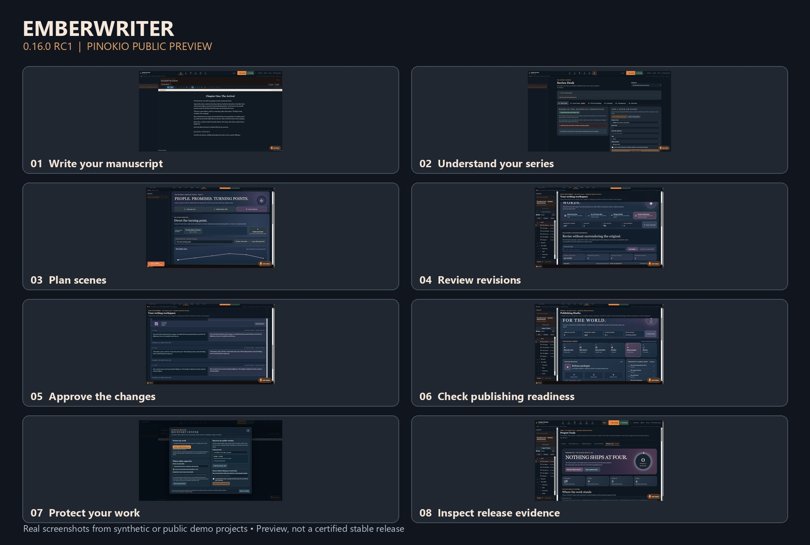
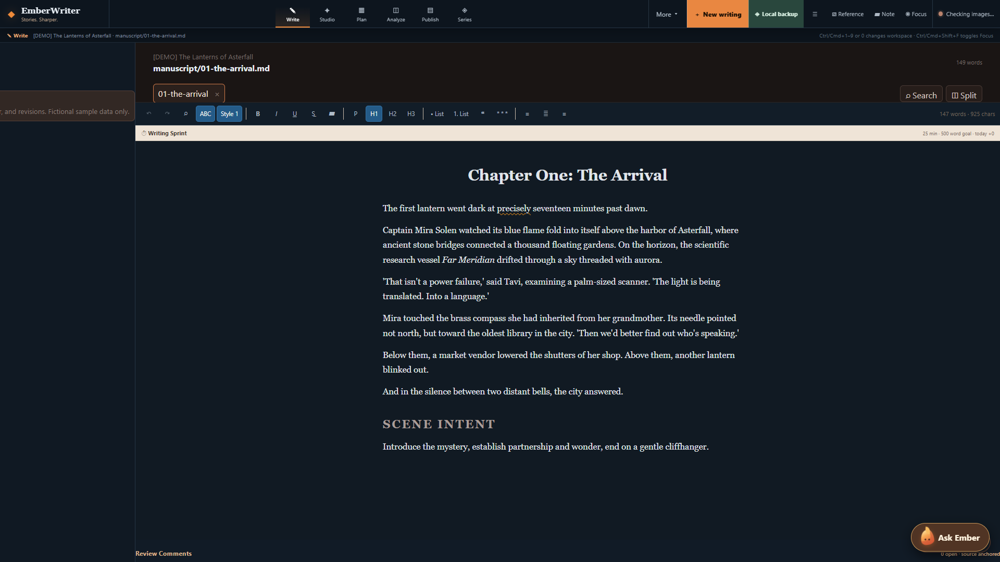
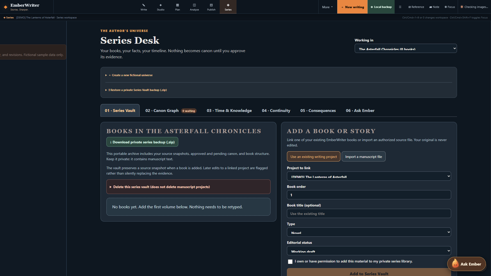
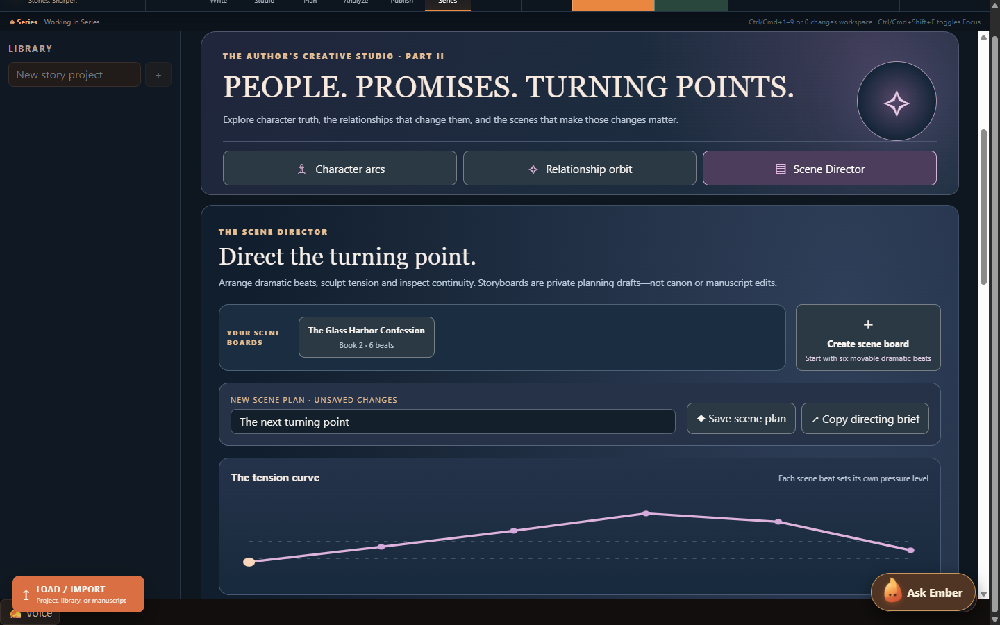
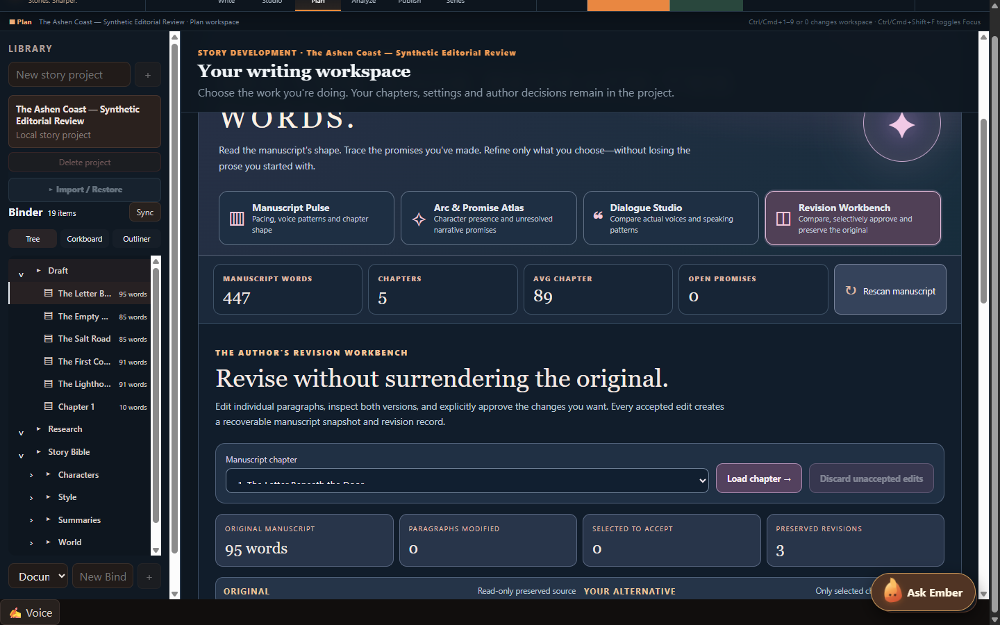
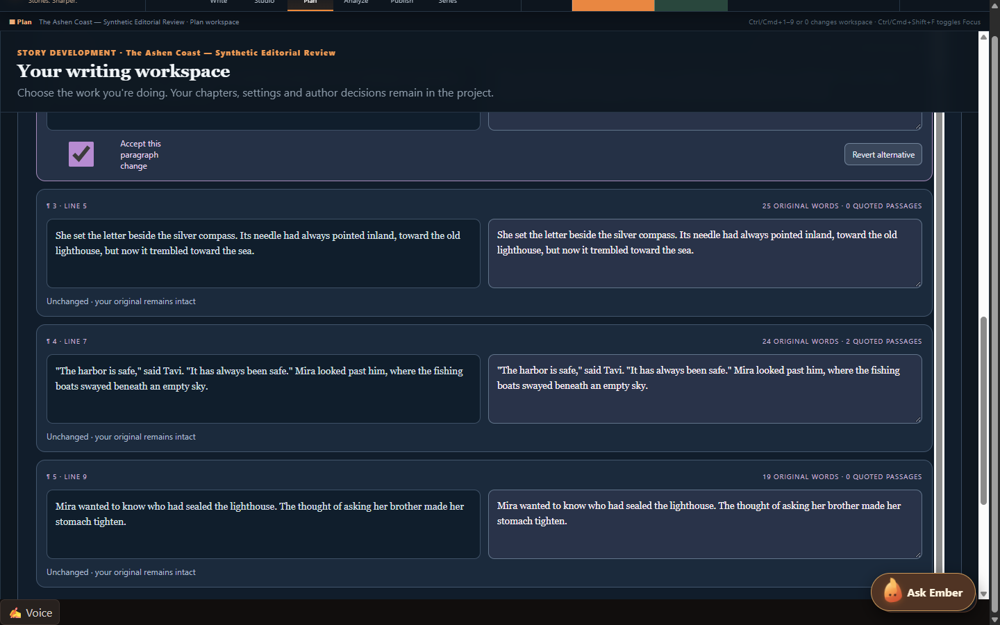
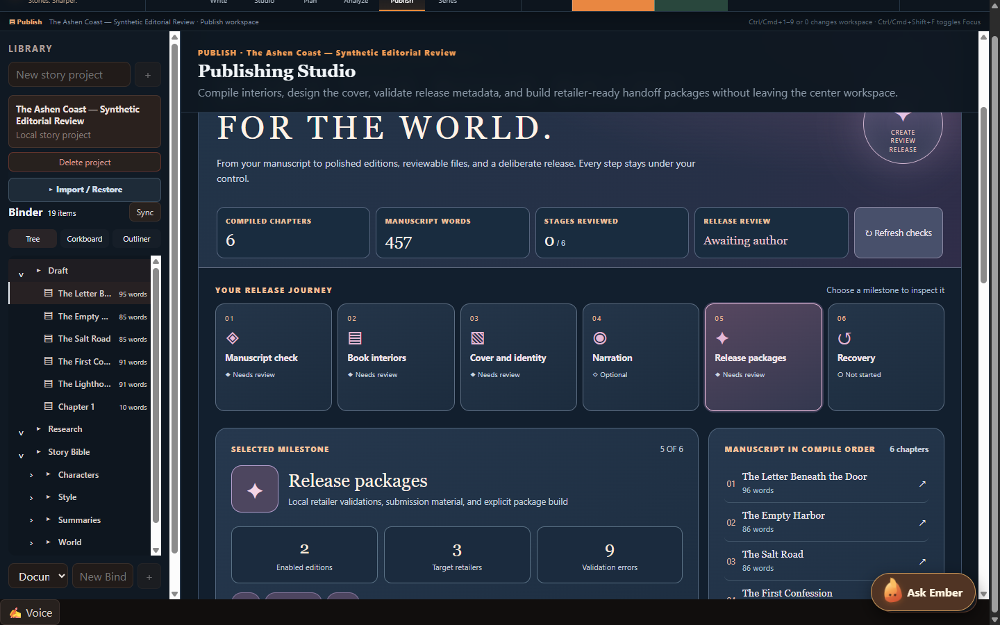
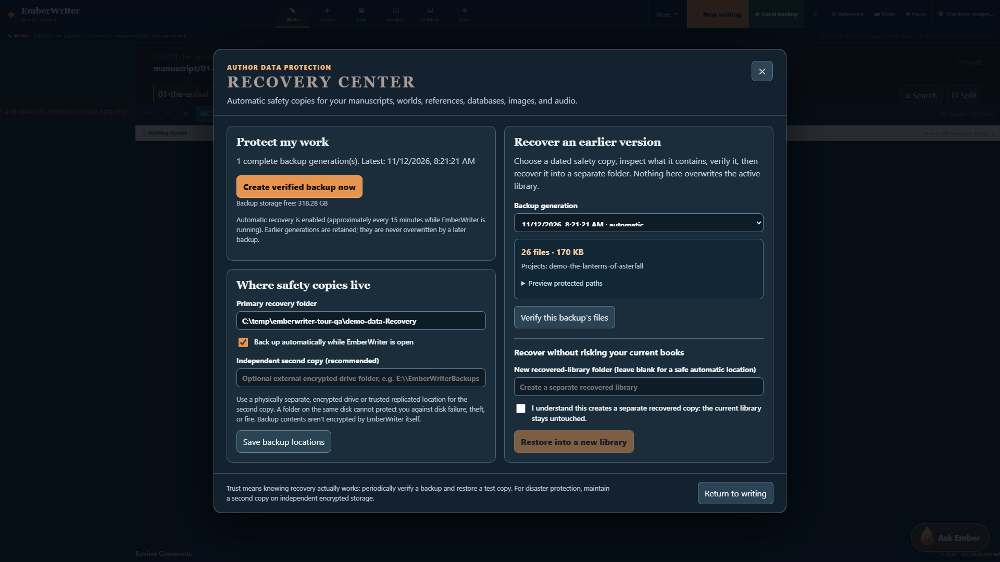
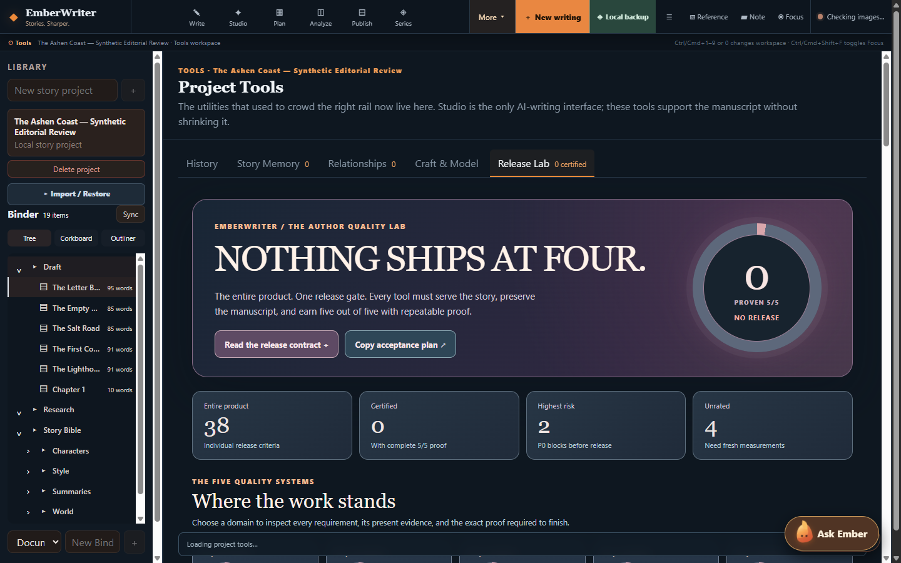

# EmberWriter 0.16.0 RC1 — Pinokio community announcement

**EmberWriter 0.16.0 RC1 is available as a public preview for Windows through Pinokio.**

Writing a novel often means keeping several different versions of the story in your head: what actually happened, what each character knows, what you planned to happen next, and what changed when you rewrote the last chapter. Most writing tools handle the words well enough; keeping that larger story straight is where the work gets messy.

EmberWriter is a local-first fiction studio built around that problem. The writing desk is still where the work happens, but this RC adds more connected ways to plan scenes, examine continuity across books, review edits, and prepare a manuscript for export. The author makes the decisions. A suggested revision doesn't quietly replace a chapter, and a drafted scene doesn't automatically become canon.

In this preview you can explore:

- **Write:** a chapter-focused writing desk with revision and recovery tools.
- **Series Intelligence:** characters, locations, timelines and source-linked evidence for longer stories.
- **Scene Director:** arrange scene beats, tension and character involvement, then hand a confirmed brief to Scene Writer.
- **Revision Workbench:** compare suggested edits and decide what to keep.
- **Publish:** prepare exports and inspect format, metadata and release-readiness warnings.
- **Release Lab:** see technical checks and outstanding blockers rather than a made-up quality score.

The screenshots below use synthetic or public demonstration projects. They are real application captures, not mockups of a finished product.

## Try RC1 in Pinokio

1. Open Pinokio on **Windows x64** (version 8 or later).
2. Choose **Download from URL** and enter `https://github.com/grumpystrongman/EmberWriter-Pinokio`.
3. Select branch **`release/0.16.0-rc.1`** for this preview. The default branch is a different release track.
4. Install the launcher and open **DEMO** first. Keep PRIVATE writing backed up separately before trying a new version.
5. Install an optional local writing model if you want to test generation; model downloads are not bundled.

**Application release:** https://github.com/grumpystrongman/EmberWriter/releases/tag/preview-0.16.0-rc.1

**Pinokio launcher release:** https://github.com/grumpystrongman/EmberWriter-Pinokio/releases/tag/preview-0.16.0-rc.1

This is an RC/developer preview, **not** a production-certified 5/5 release. Automated backend, frontend, Windows same-host and launcher tests passed, and the synthetic accessibility audit found zero automatic violations across 18 screen/viewport checks. There are still outstanding security/reliability findings, fresh-device Pinokio installation and manual accessibility checks, and real-model literary QA. I'm publishing the preview so people can see the direction and test it in the isolated DEMO workspace, not because those remaining checks are finished.

If you try it, the feedback I'm most interested in is whether a real writing session flows naturally from a scene plan to a draft and a reviewed revision. That's the experience worth getting right.

---

**Screenshot pack and captions:** [RC1 screenshots](../media/rc1/README.md). All eight images are from synthetic or public demo material.
