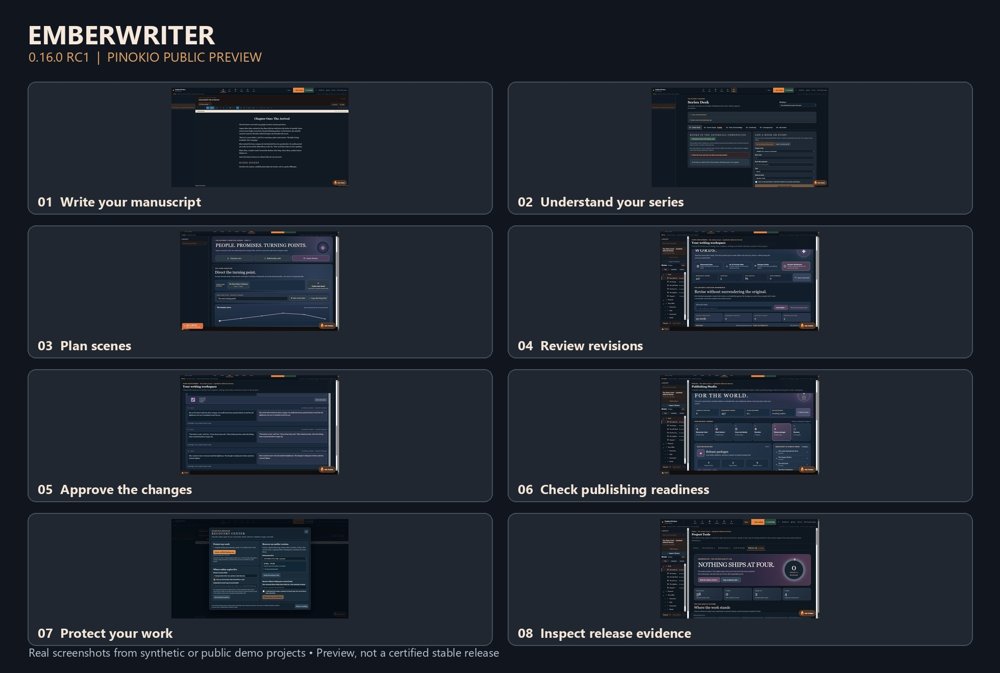

# EmberWriter 0.16.0 RC1 — Screenshot kit

**Eight real EmberWriter application captures.** Screens were created with public demo or synthetic projects, not private author manuscripts. They represent the feature experience at different points in the RC1 development cycle; they are not a single end-to-end session or proof that all release gates passed. Use them in the order below for the Pinokio post.

| Order | Screenshot | Suggested caption |
| --- | --- | --- |
| 01 | [Writing desk](01-writing-desk.png) | Write and revise chapters in one author-first workspace |
| 02 | [Series intelligence](02-series-intelligence.png) | Track people, places, evidence and continuity across a series |
| 03 | [Scene Director](03-scene-director.png) | Build a scene with beats, characters, tension and objectives before drafting |
| 04 | [Revision Workbench](04-revision-workbench.png) | Examine alternatives without silently replacing the manuscript |
| 05 | [Review the changes](05-review-the-changes.png) | Compare selected revision changes before accepting them |
| 06 | [Publishing checks](06-publishing-checks.png) | Review format, metadata and distribution readiness before export |
| 07 | [Recovery Center](07-recovery-center.png) | Keep project snapshots and recovery tools close to the writing workflow |
| 08 | [Release Lab](08-release-lab.png) | Inspect quality gates and supporting technical evidence |

## Suggested Pinokio display order

Lead with **01 Writing Desk** (familiar, accessible entry point), then **02 Series Intelligence**, **03 Scene Director**, **04 Revision Workbench**, **05 Review Changes**, **06 Publishing Checks**, **07 Recovery Center**, and **08 Release Lab**. For a shorter four-image post, select **01, 02, 03, 06**.

**Release status:** developer preview / 0.16.0 RC1. The app and the pinned launcher are published as GitHub prereleases. Not a certified stable release. Complete SonarCloud qualification, physical Pinokio GUI acceptance, NVDA/manual keyboard checks and real-model literary evaluation remain outstanding.

**Pinokio URL:** https://github.com/grumpystrongman/EmberWriter-Pinokio

**Choose the RC1 launcher branch:** `release/0.16.0-rc.1` — do not assume the default `main` branch is on this preview.

**Application release:** https://github.com/grumpystrongman/EmberWriter/releases/tag/preview-0.16.0-rc.1
